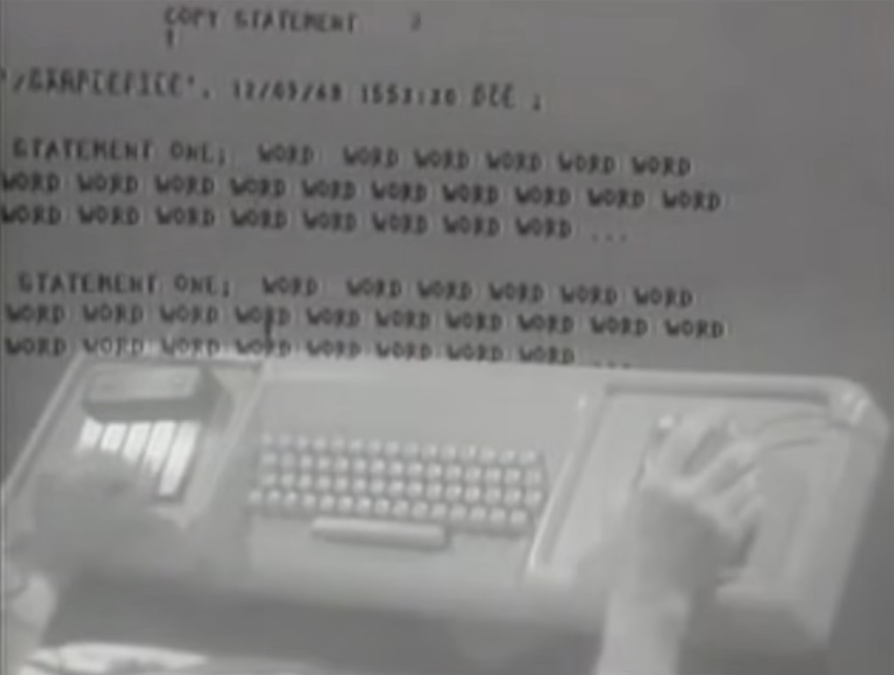
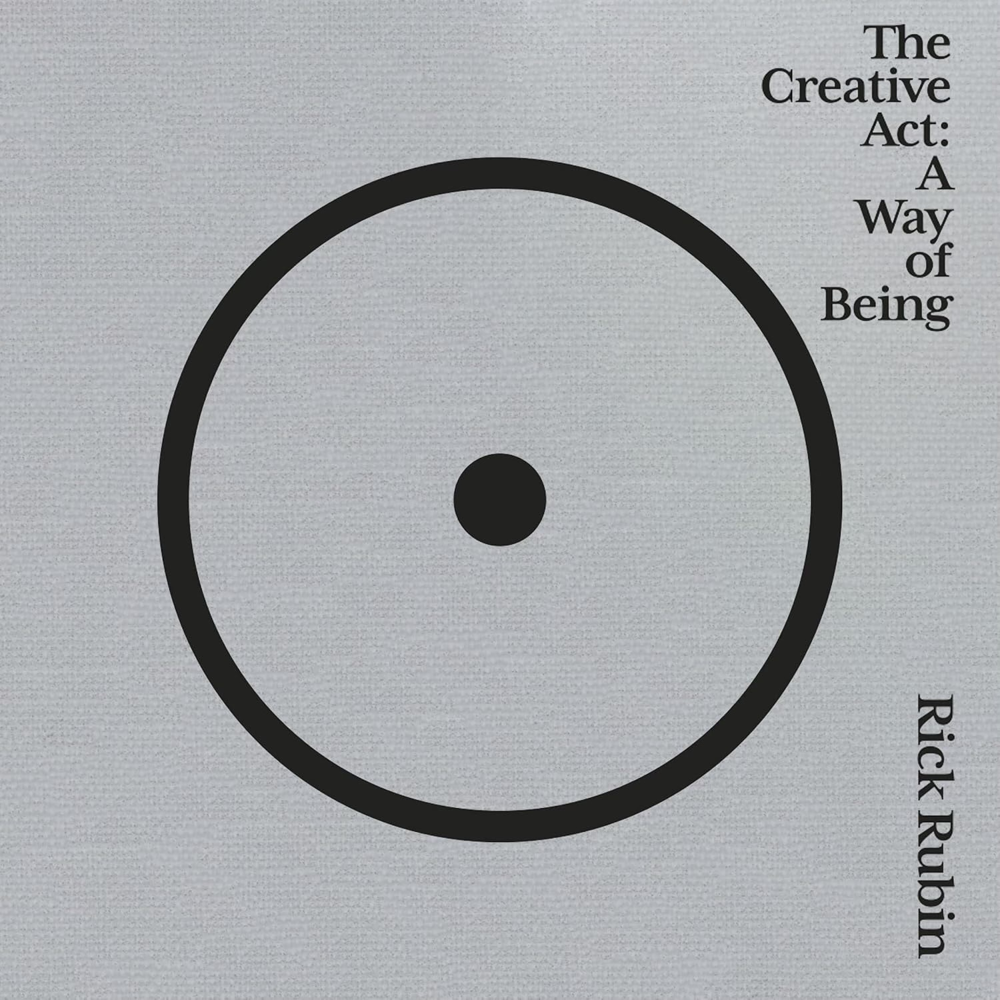
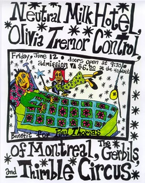
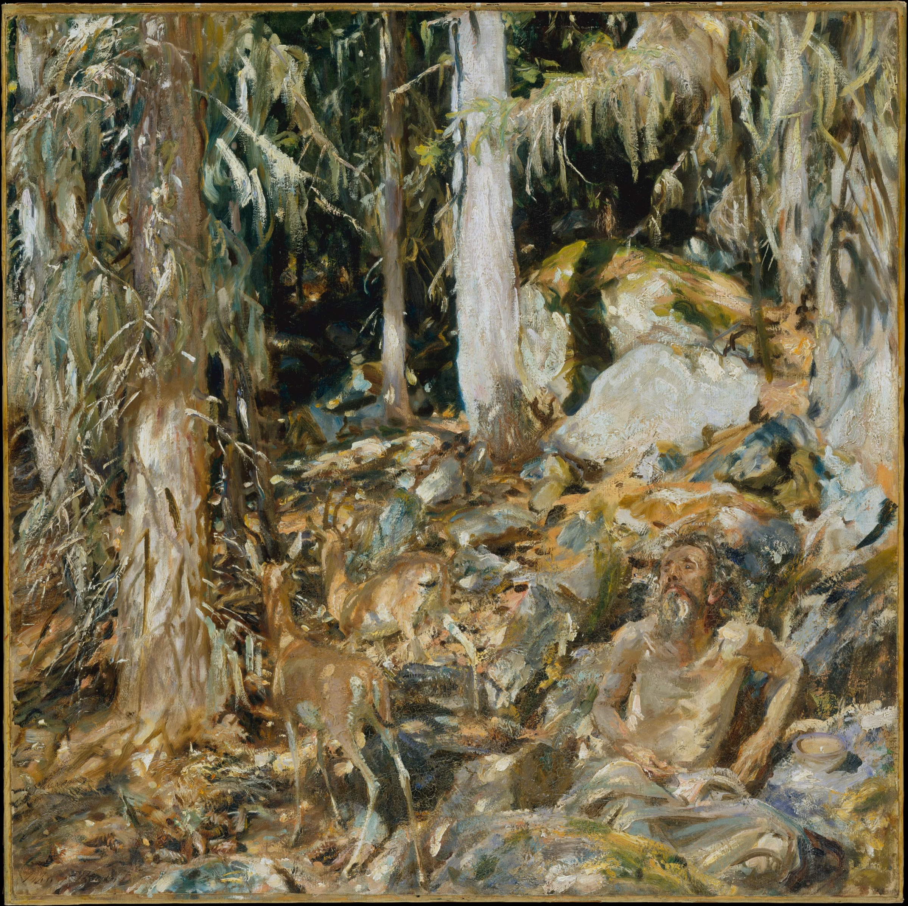
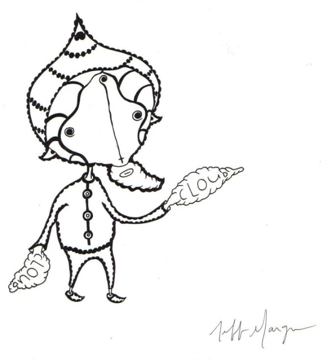
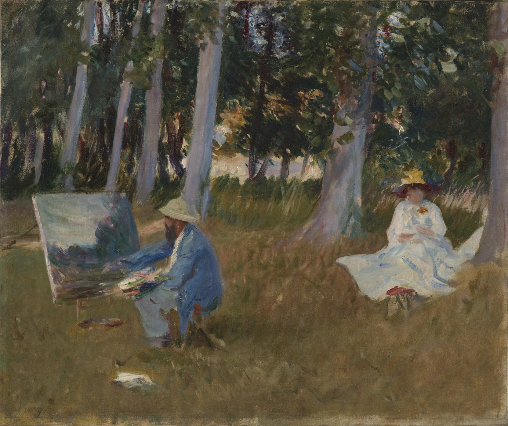
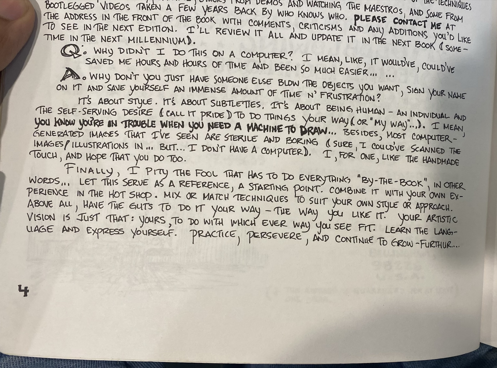
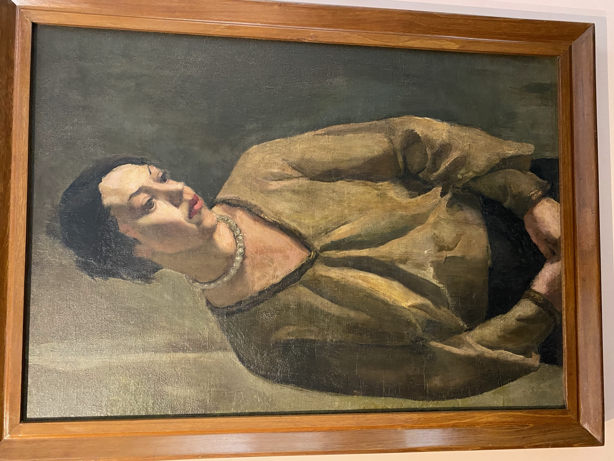

We live in label-less times

The visible work, has never been as easy to replicate

What remains, what matters, is what you do in the physical world

And the ideas you are driven by

These are mine

- **Power of tools**: The tools we use influence what we create, how we create, and over time, how we act.

- **Technology is a tool:** I believe in computer systems as "bicycles for the human mind".

- **Technology is dangerous:** It is harder for people to spot the effects of technology on them. They are cognitive, build over time, and are harder to get rid of.

- **Dark patterns are disgusting and depraved**

- **Human Autonomy:** The ultimate goal of technology is to increase human capability and preserve human autonomy.

- **Malleability:** I treat everything (systems, people, life) as [malleable](https://itsmalleable.com) to some extent. 


  

[more](https://shaurya.site/painting)

  
  
I have been painting ever since I gained consciousness and have exhibited my work twice.

Painting helps me explore ideas and themes deeper. My work always starts with a strong theme or emption. The act of painting helps me explore it further and unravel it.

  



  
Inspired by Folk music, Medivial Fantasy and world building, Privacy-first technology, Human-Computer Interaction, Human-Centered Computing (HCC), Positive Technology, Human Autonomy

Creative influences include John Singer Sargent, Amrita Shergil, Douglas C. Engelbart, Bret Victor, Rick Ruben, Matty Healy, [Jeff Mangum](https://www.neutralmilkhotel.org/faq.htm), George RR Martin and Paul Graham.
  
  

  

