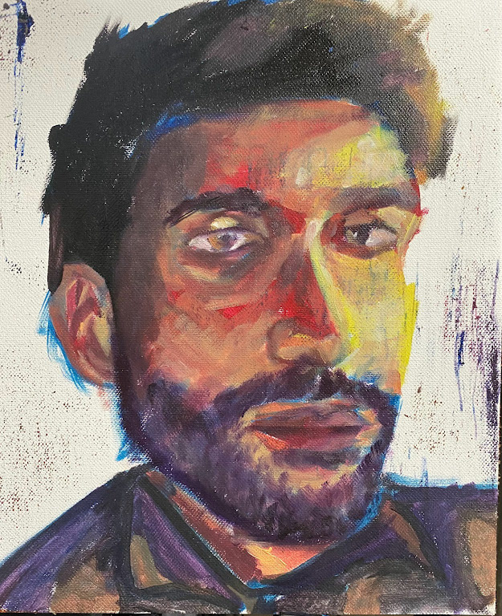


  

  
  
I am a designer who likes messy things. I like untangling the strings, understanding all the nuances, and building mental models. Design is usually what comes out of that.

I like simplicity, craft, and thinking from first principles.
#### Experience

[Wongdoody](https://www.wongdoody.com) · *since July 2025*

**User Experience Lead**

I lead design on Infosys's flagship AI platform, working closely with engineers under direct CTO oversight.

**AI Council Member**

Training our 300+ designers on designing with AI. I ran 15+ training sessions in my first year at the company and started a newsletter.

---

[Digital Impact Square](https://www.digitalimpactsquare.com) · *Jan to May 2025*

**Design Fellow**

I was embedded in an agri-waste startup, and lived on a farm to research North India's stubble-burning crisis. I mapped the whole ecosystem and spoke to farmers. That became a low-cost compaction device a farmer can run themselves.

---

Yaatrip · *2024*

**Junior Product Designer**

Sole designer at a social travel startup. 

---

[Rural Modern Glass Studio](https://ruralmodern.glass)  · *2023*

Industrial Design Intern 

Designed lighting, architectural and glass products in Mumbai, and managed studio production.

---

[MRM](https://www.mrm.com) · *2022*

Art Intern

Marketing campaigns for GreenLam, VH1, Daikin and Glance.

#### Education

BDes, Product Design 2021 - 2025

Atlas Skilltech University

Say hi - [LinkedIn](https://linkedin.com/in/ssdkr/) · [Email](mailto:shauryasinghdkr@gmail.com)
  



  
Painting helps me explore ideas and themes deeper. My work always starts with a strong theme or emption. The act of painting helps me explore it further and unravel it.

I’ve been painting ever since I gained consciousness. Have exhibited my work twice.
  
  

  

